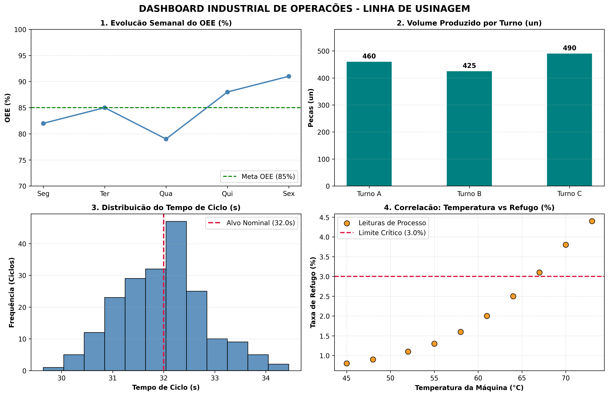

# Dashboard Industrial de Operações — Linha de Usinagem

Painel analítico desenvolvido em **Python (`Matplotlib` e `NumPy`)** para monitoramento integrado de eficiência global, estabilidade de ciclo e qualidade de processo em uma linha de usinagem e montagem.

---

## Diagnóstico de Engenharia Extraído do Painel

* **1. Evolução Semanal do OEE (%):** O indicador iniciou a semana abaixo da meta operacional (82% na segunda-feira e queda para 79% na quarta-feira), recuperando consistência na quinta (88%) e sexta-feira (91%), superando o alvo de 85%.
* **2. Volume Produzido por Turno (un):** O Turno C liderou a entrega com **490 unidades**, operando 15,3% acima do Turno B (**425 unidades**), indicando oportunidade de balanceamento de setup ou ritmo operacional entre turnos.
* **3. Distribuição do Tempo de Ciclo (s):** A análise de 200 ciclos mostra distribuição normal centrada no alvo nominal de **32,0 segundos**, confirmando estabilidade e repetibilidade do tempo padrão do equipamento.
* **4. Correlação Temperatura vs. Refugo (%):** Evidencia forte correlação positiva entre o aquecimento da máquina e o índice de refugo. A partir de **67 °C**, o processo rompe o limite crítico tolerado pela qualidade (**3,0%**), atingindo **4,4%** aos 73 °C — apontando necessidade de intervenção preventiva no sistema de refrigeração antes desse patamar térmico.

---

## Tecnologias Utilizadas

* **Python 3**
* **Matplotlib** (`subplots` em grade matricial 2×2, controle granular de eixos `ax[i, j]`, linhas de referência crítica e exportação em 300 DPI)
* **NumPy** (simulação estatística de distribuição normal de ciclos)
* **Google Colab**
